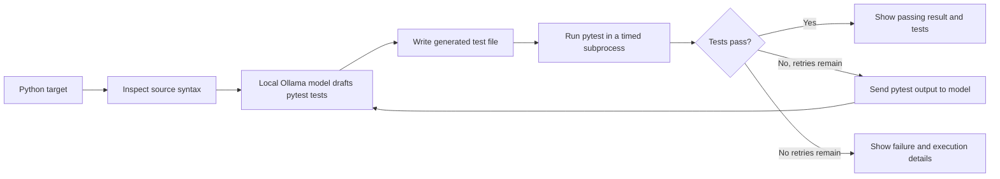

# Open Test

**A local-first workbench that drafts, runs, and repairs pytest tests for Python modules.**

Open Test uses the locally installed `qwen2.5-coder:3b` model through Ollama to create a first test suite for a Python file. It executes that suite with pytest, then sends failures and traceback output back to the model so it can revise the tests. The cycle ends when pytest passes or the configured retry limit is reached.

The project is built around a practical idea: make test generation an executable feedback loop instead of stopping at suggested code. The dashboard makes that loop visible, with the target and generated tests side by side, a run action, activity logs, and execution details.

## The problem Open Test addresses

Writing useful tests takes time, and a generated test that has never been run can be misleading. Developers still need to install and configure a model, turn its output into a test file, run it, interpret failures, and ask for a correction. Open Test connects those steps in one repeatable workflow.

It is designed to help with:

- **Getting a first draft sooner:** generate a pytest suite from a Python module without starting from a blank test file.
- **Closing the feedback loop:** use real pytest output, including assertion failures and tracebacks, to guide bounded test repairs.
- **Keeping model inference on the machine:** use Ollama and a local open-weight model instead of sending source code to a hosted model API.
- **Making the process inspectable:** show the target, generated tests, iteration log, and captured execution details in one workbench.

## What is innovative about it

Open Test brings local model inference and actual test execution into the same small development workflow. Its distinguishing feature is the **run-and-repair loop**: pytest is the source of feedback, and the model is asked to adjust the generated tests in response to that feedback. The implementation bounds both model calls and test execution, and makes each attempt visible in the CLI or dashboard.

This is a practical workflow innovation rather than a claim that AI-generated tests are automatically complete or correct. A passing run means the generated tests passed against the supplied module in that run; it does not prove that the tests cover every behavior or that the module itself is correct. Review generated tests like any other code.

## How a run works



The default allows an initial generation plus up to three repair attempts. Each model request has a 180-second timeout and a 1,024-token output limit. Each pytest subprocess is capped at 10 seconds and stops after its first test failure. The repairs change the generated test file; they do not modify the target module.

## Project layout

```text
Open_Test/
├── app.py                    # Streamlit test workbench
├── target_code.py            # Built-in example module
├── test_target.py            # Optional example / generated test file
├── requirements.txt          # Python dependencies
├── SKILL.md                  # Agent skill entry point
├── LICENSE                   # MIT license
├── assets/
│   └── open_test.svg         # App icon
└── harness/
    ├── __init__.py
    ├── ast_inspector.py      # Python syntax inspection
    ├── generator.py          # Ollama generation and repair loop
    └── runner.py             # Timeout-bounded pytest subprocess
```

### Main components

- **`harness.generator.TestForgeEngine`** coordinates local generation, test-file writing, pytest execution, failure feedback, progress events, and retry limits. The module also provides a CLI entry point.
- **`harness.runner.run_test`** launches pytest with the active Python interpreter, captures stdout and stderr, and returns a stable result structure, including on timeout or process-start failure.
- **`harness.ast_inspector.inspect_python`** parses Python source and reports syntax errors before execution. It also lists top-level functions and classes for consumers of the inspection result.
- **`app.py`** provides a Streamlit workbench with a built-in demo, `.py` upload, target and test previews, runtime status, activity log, and execution details.
- **`target_code.py`** is the demo module used to show generated tests against boundary conditions.

## Requirements

- Python 3.10 or newer
- [Ollama](https://ollama.com/) installed and running locally
- The `qwen2.5-coder:3b` model downloaded in Ollama
- macOS on Apple Silicon is the intended setup; Ollama can use Metal acceleration on supported Apple Silicon systems

Python packages are listed in [`requirements.txt`](requirements.txt): Ollama's Python client, pytest, pytest-cov, and Streamlit.

## Get started

From the project directory, create an environment and install the Python dependencies:

```bash
python3 -m venv .venv
source .venv/bin/activate
python -m pip install -r requirements.txt
```

Install and start Ollama if it is not already available, then download the model:

```bash
ollama pull qwen2.5-coder:3b
```

Ollama normally serves locally at `http://127.0.0.1:11434`. Open Test defaults to that loopback address. You can set `OLLAMA_HOST` to another loopback address; non-loopback endpoints are rejected to keep model calls local.

## Use the command line

Generate and run tests for the included target:

```bash
python -m harness.generator --target target_code.py
```

Choose a different Python target, output file, or number of repair attempts:

```bash
python -m harness.generator \
  --target path/to/your_module.py \
  --test-file path/to/test_your_module.py \
  --max-retries 3
```

Options:

| Option | Default | Purpose |
| --- | --- | --- |
| `--target` | `target_code.py` | Python source file to provide to the model |
| `--test-file` | `test_target.py` | Path where generated tests are written and run |
| `--max-retries` | `3` | Number of repair attempts after the initial generation |

The CLI reads the target as UTF-8. Its generated file is written at the selected path, and pytest runs against that file. The generator asks the model to import the target as `target_code`; for a custom CLI target, make that source importable as `target_code` from the pytest working directory. The dashboard handles this automatically by placing each selected source in a per-run directory under that name. A nonzero CLI exit code indicates setup, generation, or test failure.

## Use the dashboard

Start the local dashboard:

```bash
streamlit run app.py
```

The dashboard opens in **Demo mode**, with `target_code.py` selected. Turn Demo mode off to upload another `.py` file. Review the target preview, select **Run tests**, and follow model and pytest progress in the activity panel. The generated tests and execution output remain available in the results area after a run.

Each dashboard run gets its own directory under `.open_test_runs/`, containing a copy of the selected module and its generated tests. This prevents an upload or repair from overwriting the built-in demo module. The source and test previews have independent scroll areas. The **About** popover includes a short project description and credits Chitransh Singh and Harsh Singh.

## Demo module

The included [`target_code.py`](target_code.py) has two functions with boundary conditions for generated tests:

- `calculate_discount(price, tier)` validates finite, non-negative prices, supports `standard` (0%), `silver` (10%), and `gold` (20%) discounts, accepts tier names without regard to case, and rounds the final price to two decimal places.
- `clean_username(name)` trims surrounding whitespace and keeps Unicode alphanumeric characters. `None` returns an empty string; other non-string inputs raise `TypeError`.

These functions provide a deterministic example for the test-generation workflow. They are not required by the harness: the dashboard accepts other syntactically valid Python modules, and the CLI accepts a different source path when it is importable as `target_code` during pytest execution.

## Local execution and privacy

Model requests are made to the local Ollama service. The application and generator do not use an external model API. The Streamlit dashboard also checks runtime readiness through the local Ollama tags endpoint.

**Python execution is not sandboxed.** pytest executes generated tests and imports the selected module on your machine, with the permissions of the user running Open Test. Only upload and run source code you trust. The 10-second pytest timeout limits how long the subprocess runs; it is not a security boundary.

Dashboard run folders are kept in `.open_test_runs/` so the interface can display the generated tests and execution output. Remove that directory when you want to clear saved run files.

## Known limits

- The model may generate incorrect, incomplete, or brittle tests. A passing test run does not establish coverage or correctness.
- Repairs are limited to the generated test file and the configured retry count; Open Test does not edit production code to make a test pass.
- The harness currently targets Python modules and pytest. It does not generate tests for other languages or test frameworks.
- Model generation requires the Ollama service and `qwen2.5-coder:3b` to be installed and available locally.
- pytest runs stop after the first failure and are terminated after 10 seconds.

## License

Open Test is distributed under the [MIT License](LICENSE).
